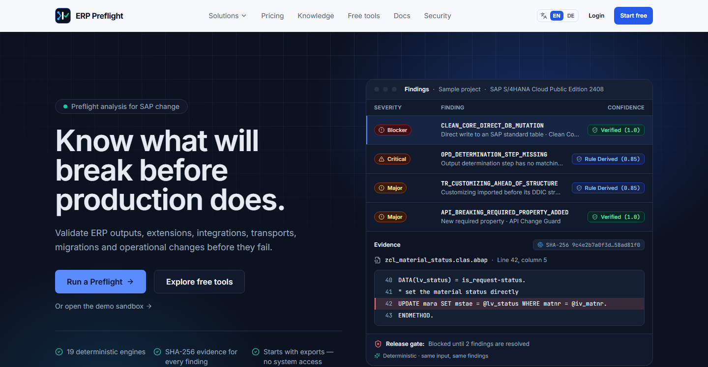
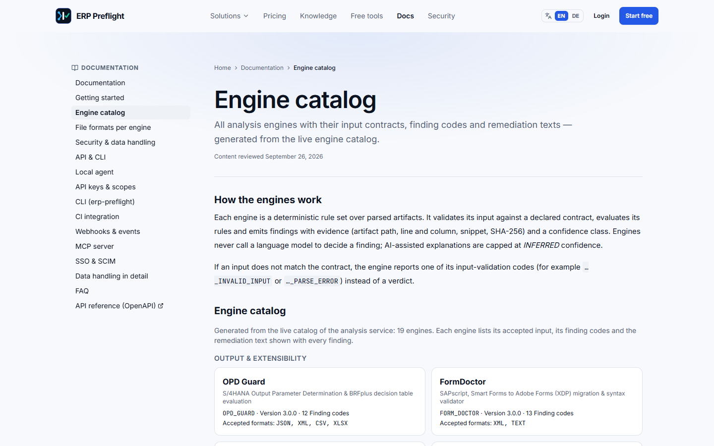
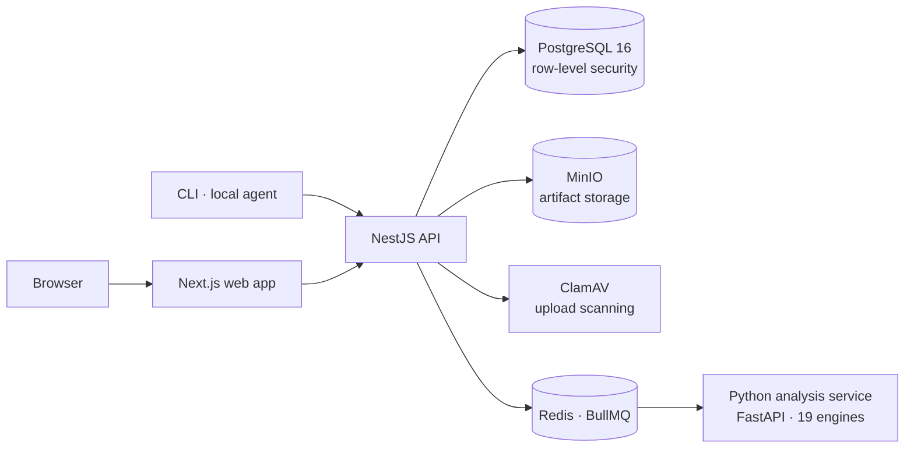
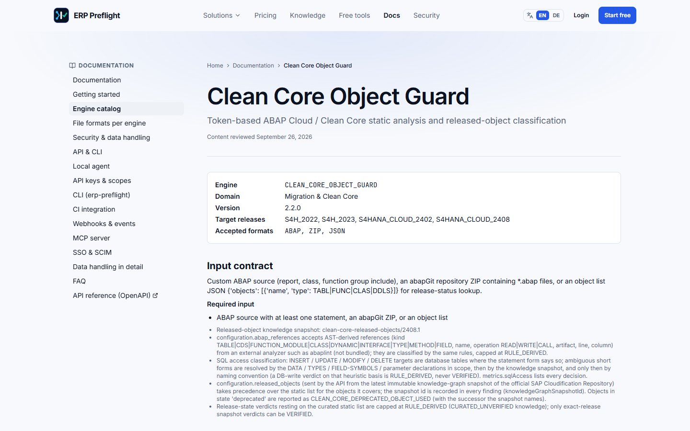

# ERP Preflight

**Deterministic preflight analysis for SAP changes.** Upload SAP artifacts — ABAP sources, abapGit
exports, API metadata, transport lists, customizing and output configuration — and get findings that
point to the exact file, line and SHA-256 before the change reaches production.

**Live:** [erppreflight.com](https://erppreflight.com) · [Engine catalog](https://erppreflight.com/en/docs/engines) · [Documentation](https://erppreflight.com/en/docs)

> This repository is a public **showcase**: idea, architecture, structure and selected code excerpts.
> The product source code is private.

## The idea

SAP changes usually fail late: a Clean Core violation found in the ATC run before go-live, an
output determination step nobody configured, a transport imported before the DDIC object it
depends on, an OData property that silently became mandatory. The information to catch these
issues is already in the artifacts — ERP Preflight checks it automatically, without access to the
SAP system.

1. **Upload** SAP artifacts (files or ZIP archives).
2. **Analyze** them with deterministic engines: the same input always produces the same findings.
3. **Review findings with evidence** — file path, line, SHA-256 and a confidence class
   (`VERIFIED`, `RULE_DERIVED`, `INFERRED`).
4. **Export reports** (PDF, XLSX, CSV, JSON, HTML) or use the findings as a release gate in CI.

## 19 analysis engines

| Area | Engines |
|---|---|
| Clean Core & extensibility | Clean Core Object Guard · Extension Impact Guard · Custom Field Flow Doctor · Software Collection Dependency Guard · SAP Gap Radar |
| Migration to S/4HANA Cloud | ECC2Cloud Navigator · SPRO2Cloud · Safe Decommission Preflight |
| Integration & APIs | API Change Guard · Change Pointer Coverage Auditor |
| Transports & operations | Transport Dependency Analyzer · System Refresh Delta Guard · Workflow Stuck Explainer · MFS BlackBox · Fiori 403 Root-Cause Doctor · IAM Cost Optimizer |
| Output & configuration | OPD Guard · FormDoctor · Account Determination Preflight |

Input contracts and finding codes of every engine are published in the
[engine catalog](https://erppreflight.com/en/docs/engines).

## How it is built

| Part | Technology | Role |
|---|---|---|
| Web app | Next.js 15, React 19, TypeScript | App UI and public site (EN/DE) |
| API | NestJS 11, TypeScript | Auth, tenancy, uploads, findings, reports, audit trail, billing, SSO, webhooks |
| Analysis service | Python, FastAPI | Parsers (ABAP tokenizer, abapGit, safe XML/ZIP) and the 19 rule engines |
| Data | PostgreSQL 16 (+ pgvector), Redis/BullMQ, MinIO | Tenant data with row-level security, job queue, artifact storage |
| Delivery | Docker, Turborepo/pnpm, GitHub Actions | Monorepo build, container images, CI |

Details — monorepo structure, request flow, security model and engineering practices:
**[docs/architecture.md](docs/architecture.md)**

## Selected code

| Excerpt | What it shows |
|---|---|
| [`evidence.schema.ts`](excerpts/evidence.schema.ts) | Shared zod contract for the evidence behind every finding |
| [`base_engine.py`](excerpts/base_engine.py) | Base class of all engines: rule inventory, input contract, rule versioning, health, adversarial contract probes |
| [`tenant-rls.sql`](excerpts/tenant-rls.sql) | Tenant isolation with PostgreSQL row-level security |
| [`with-tenant-transaction.ts`](excerpts/with-tenant-transaction.ts) | Tenant-scoped transactions in the API |

## Engineering highlights

- **Tenant isolation in the database** — row-level security on every tenant table; the API cannot bypass it.
- **Evidence you can verify** — path, line, SHA-256 and provenance for every finding; missing values are
  reported as `UNKNOWN`, never guessed.
- **Deterministic engines, governed AI** — findings come from rules; AI explanations are optional and capped.
- **Tested at several levels** — thousands of unit and integration tests, golden tests for every finding
  rule, end-to-end suites against real PostgreSQL, Redis, MinIO and ClamAV.
- **Secure by default** — safe uploads, CSRF-protected sessions, TOTP 2FA, audit hash chain, OIDC SSO, SCIM.

## Status

Active development. The public site at [erppreflight.com](https://erppreflight.com) is live; the product is
being verified on the production deployment.

## Author

**Taha Khattari** — [LinkedIn](https://www.linkedin.com/in/taha-khattari/) · [GitHub](https://github.com/enwecklerpro)

© 2026 Taha Khattari. All rights reserved. The excerpts are published for portfolio review only.
