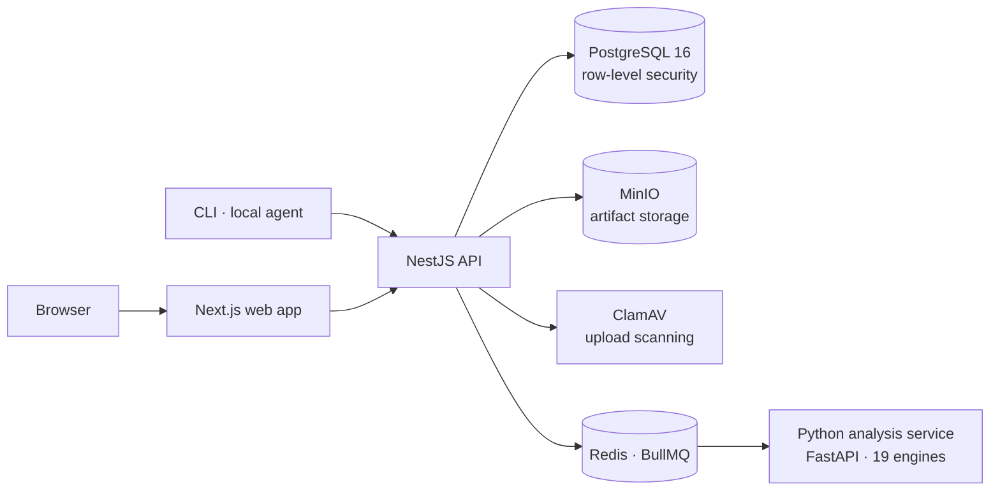
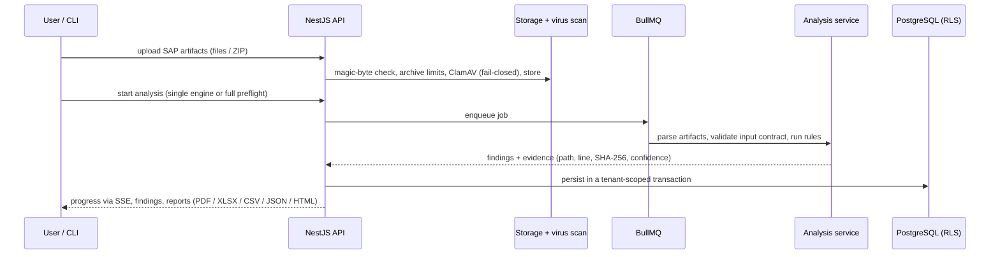

# Architecture

## System overview



## From upload to finding



Engines are deterministic: the same input produces the same findings. When the input does not match
an engine's contract, the engine returns an input-validation code (`…_INVALID_INPUT`,
`…_PARSE_ERROR`) instead of a verdict.

## Monorepo structure

```
apps/
  web/            Next.js 15 + React 19 — app UI and public site (EN/DE)
  api/            NestJS 11 — 58 feature modules, e.g.:
                  auth · organizations · projects · ingestion · analyses · findings · export
                  audit · billing · sso · webhooks · api-keys · connectors · mcp · rate-limit
  local-agent/    On-premise extraction agent (enrollment, signed jobs, revocation)
packages/
  schemas/        Shared zod contracts (findings, evidence, analyses, plans, …)
  database/       PostgreSQL client and SQL migrations
  auth/           JWT and permission model
  tenancy/        Tenant context and guard
  evidence/       Canonical JSON, hashing, audit hash chain, offsets, release alignment, secret redaction
  cli/            erp-preflight command-line client (CI/CD quality gate)
services/
  analysis-python/
    src/core/     Engine base class, contracts, registry
    src/engines/  The 19 analysis engines
    src/parsers/  ABAP tokenizer, abapGit, safe XML / ZIP / JSON, XLSX
    src/knowledge/ SAP knowledge snapshots (e.g. Cloudification Repository)
    src/selftest/ Golden rule self-tests
infra/            Docker images, observability (alert rules, dashboard)
tests/            End-to-end (Playwright), master golden project, CI fixtures
```

## Security model

| Concern | Approach |
|---|---|
| Tenant isolation | PostgreSQL row-level security on every tenant table (`ENABLE` + `FORCE`); API runs as a non-superuser role without `BYPASSRLS`; tenant id set per transaction ([excerpt](../excerpts/tenant-rls.sql)) |
| Sessions | Cookie-only browser sessions, CSRF guard, TOTP 2FA, server-side revocation |
| Uploads | Magic-byte checks, archive depth and size limits, ClamAV fail-closed, redaction |
| Audit | Append-only audit trail with a hash chain per tenant and a verification endpoint |
| API access | API keys with resource scopes and per-key rate limits; signed webhooks |
| AI | Optional; behind a kill switch and a cost ceiling; AI-assisted explanations are capped at `INFERRED` confidence |
| Enterprise | OIDC single sign-on, SCIM 2.0, IP allowlist |

## Engineering practices

- **Tests:** unit and integration tests for API, web, CLI and local agent; property-based tests for the
  parsers; golden tests for every finding rule; a "master golden project" that runs all 19 engines in one
  full preflight; Playwright end-to-end suites against real PostgreSQL, Redis, MinIO and ClamAV.
- **Contract tests:** every engine must reject adversarial input (empty, random bytes, nesting bombs,
  malformed XML/JSON) without producing a verdict ([`base_engine.py`](../excerpts/base_engine.py)).
- **Rule versioning:** each rule is versioned by a digest of its definition, so every stored finding
  records exactly which rule version produced it.
- **Supply chain:** Gitleaks, Trivy, Renovate, digest-pinned container images, SBOM per release.
- **Operations:** health and readiness endpoints, structured logging (Pino), OpenTelemetry tracing,
  Prometheus metrics, backup and verified restore scripts.
